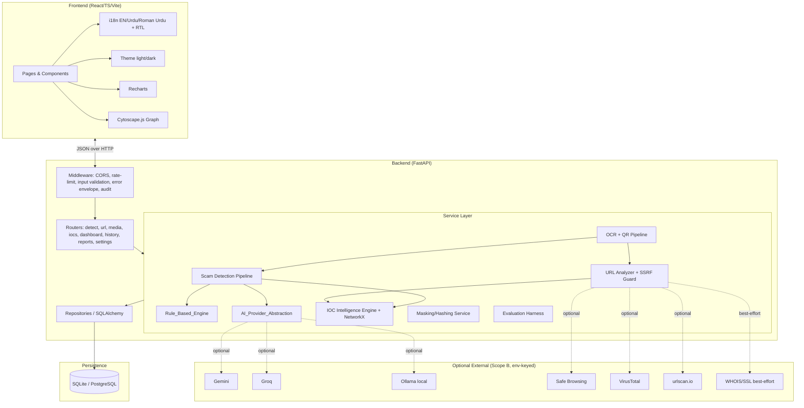
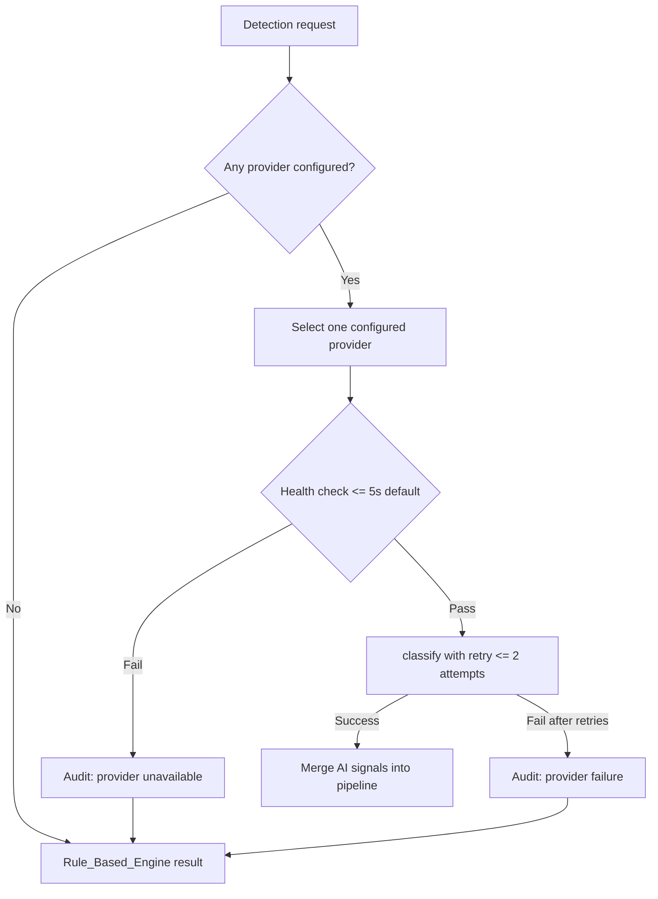
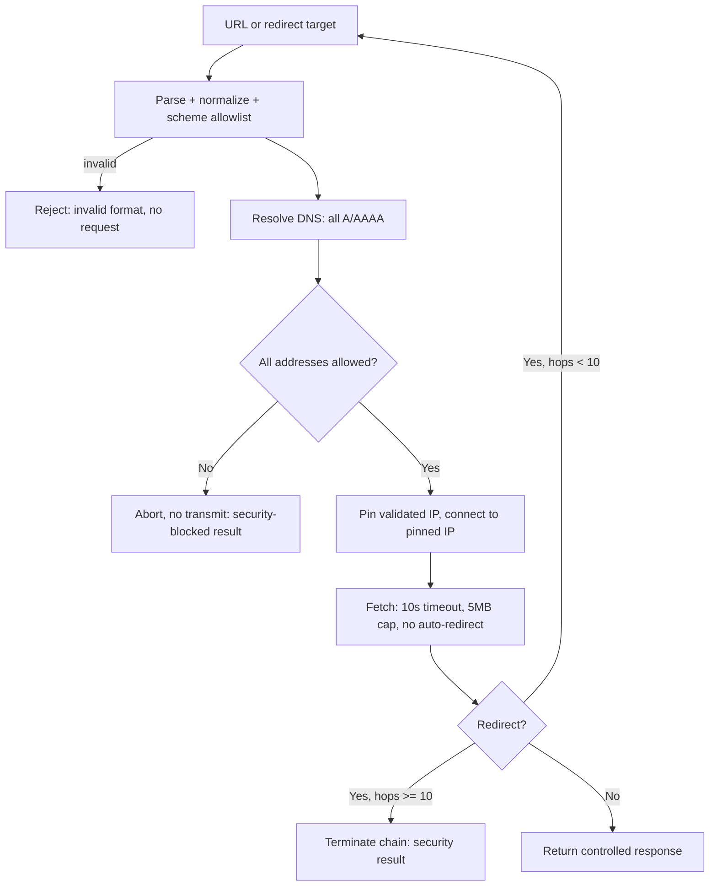
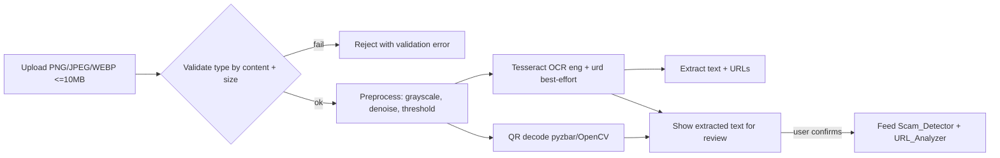
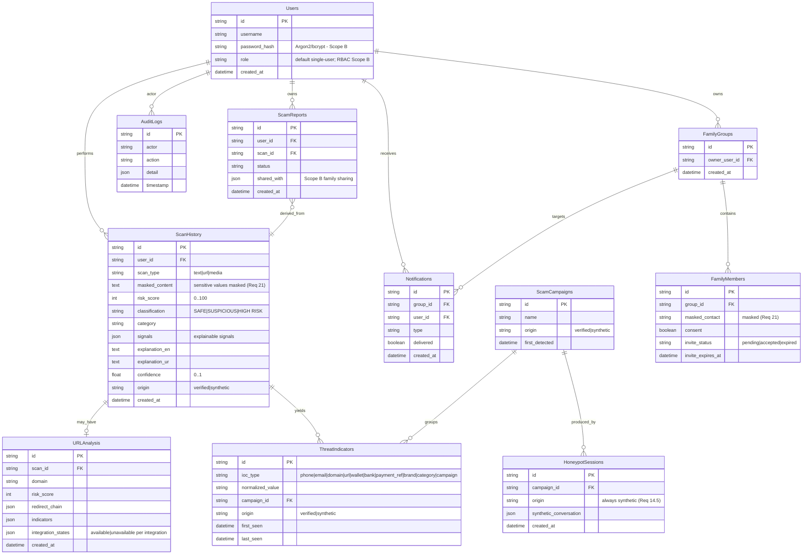
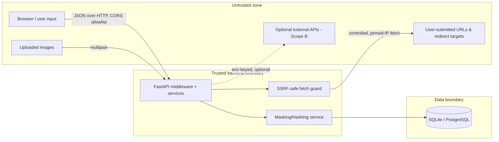

# Design Document: KHABARDAR Platform

## Overview

KHABARDAR ("Think Before You Trust") is an AI-powered, multilingual (English / Urdu / Roman Urdu) personal scam and fraud protection platform with a SOC-inspired threat intelligence experience. This design targets the **Hackathon MVP (Scope A)** approved in the requirements review as the primary deliverable, while preserving clearly-marked modular seams so **Scope B** features (honeypot Req 14, family protection Req 17, live external integrations Req 10, live cloud AI Req 8 online path, advanced campaign correlation Req 13.7/15 advanced, full auth + RBAC Req 18) can be added later without rearchitecting.

### Guiding Design Principles

1. **Rule-based first, AI optional.** The deterministic `Rule_Based_Engine` is the guaranteed detection path. The app is fully functional with **zero API keys**. Cloud/local AI providers (Gemini, Groq, Ollama) are an optional enhancement layer behind an abstraction.
2. **Security is non-negotiable.** SSRF-safe URL fetching (Req 11) must exist before any outbound fetch is enabled. URLs are never browsed from the user's browser nor auto-fetched unsafely from the backend.
3. **Honesty over appearance (Req 22, 23).** Unavailable capabilities show explicit "unavailable" states with disabled controls. No fabricated results, no invented accuracy numbers. The 0–39 / 40–69 / 70–100 `Risk_Score` thresholds are treated as an **untested initial heuristic** to be calibrated against the evaluation dataset (Req 24), not a validated standard.
4. **Privacy by default (Req 21).** Sensitive values (OTPs, passwords, tokens, PII) are masked (≤ last 4 chars, irreversible) or one-way hashed. Scam-message secrets are never stored in plaintext.
5. **Portable persistence (Req 20).** SQLite for local development with a PostgreSQL-compatible SQLAlchemy model layer (portable column types, Alembic migrations).
6. **Single-user local MVP, auth-ready.** The MVP runs as a single-user local environment with no multi-user complexity. The design keeps an authentication seam so Scope B can add JWT + RBAC + lockout (Req 18) without rearchitecting. **The application must never be exposed publicly without proper authentication and access controls in place.**

### Technology Stack

| Layer | Technology |
|-------|-----------|
| Frontend | React, TypeScript, Vite, Tailwind CSS, Recharts, Cytoscape.js, Lucide icons, react-router, i18n (react-i18next) |
| Backend | Python 3.11+, FastAPI, Pydantic, SQLAlchemy, Alembic |
| Database | SQLite (dev) / PostgreSQL-compatible schema (prod) |
| Media | Tesseract OCR (pytesseract), pyzbar/zbar or OpenCV QR decode, Pillow |
| Intelligence | NetworkX (backend graph), Cytoscape.js (frontend graph) |
| Networking | httpx (SSRF-safe guarded fetch) |

## Architecture

### System Architecture Diagram



**Data flow (headline path):** User submits content in the browser → request passes through middleware (validation, rate-limit, CORS) → router dispatches to the relevant service → service runs the pipeline (rule-based always, AI optionally, intelligence enrichment) → result is masked for privacy → persisted to `ScanHistory` → returned as a consistent JSON envelope → rendered with explainable signals in the selected language.

**Security considerations:** All outbound requests on behalf of user input (URL analysis, optional AI providers) flow through guarded clients. The SSRF-safe fetch guard gates every network hop. Secrets load only from backend env configuration and never reach the frontend bundle.

### Layered Backend Architecture

```
Routers (HTTP boundary, Pydantic request/response)
  └─ Services (business logic, orchestration)
       └─ Engines/Adapters (Rule_Based_Engine, AI providers, SSRF guard, OCR/QR, NetworkX)
            └─ Repositories (SQLAlchemy data access, parameterized)
                 └─ Database (SQLite/PostgreSQL)
Cross-cutting: Config/Secrets, Privacy (masking/hashing), Audit logging, Error envelope, Middleware
```

Dependency injection (FastAPI `Depends`) supplies database sessions, config, the selected AI provider, and the privacy service to routers/services. This keeps engines testable in isolation and keeps the auth seam ready: a `get_current_user` dependency is a no-op single-user resolver in the MVP and becomes a JWT validator in Scope B without touching routers.

## Components and Interfaces

### Frontend Architecture

**Stack:** React + TypeScript + Vite + Tailwind CSS. Recharts for charts, Cytoscape.js for the IOC relationship graph, Lucide for icons, react-router for routing, react-i18next for localization.

**Routing (Req 3.1) — all 12 pages routable in the MVP:**

| Route | Page | MVP Status |
|-------|------|------------|
| `/` | Splash | Functional (Req 1) |
| `/dashboard` | Main Dashboard | Functional (Req 3.6) |
| `/detector` | Scam Detector | Functional (Req 5–7) |
| `/url` | URL Analyzer | Functional (Req 9, 11) |
| `/scanner` | Screenshot & QR Scanner | Functional (Req 12) |
| `/intelligence` | Threat Intelligence (SOC) | Functional basic (Req 13, 15) |
| `/honeypot` | Honeypot Simulation Lab | **Scope B placeholder** — labeled "Advanced / coming soon" (Req 22.1) |
| `/family` | Family Protection | **Scope B placeholder** — labeled "Advanced / coming soon" (Req 22.1) |
| `/history` | Scan History | Functional (Req 20) |
| `/reports` | Reports | Functional (Req 20) |
| `/settings` | Settings | Functional (theme, language, retention config) |
| `/about` | About | Functional |

Scope B placeholder pages render an honest "This advanced capability is not yet available" state with disabled action controls — they are never shown as fake-functional (Req 22.1, 22.6).

**State management:**
- **Server state:** a lightweight data-fetching layer (React Query-style hooks or a thin fetch wrapper) for scan results, dashboard stats, history, reports.
- **UI/app state:** React Context for theme, language, and a `capabilities` map (which integrations/providers are available) sourced from a backend `/api/capabilities` call so the UI can honestly disable controls.
- **Form state:** local component state; user input is preserved on error (Req 22.7) by never clearing the input field until a successful result returns.

**Internationalization (Req 4):**
- `react-i18next` with resource bundles for `en`, `ur` (Urdu), and `ur-Latn` (Roman Urdu).
- Default language English (Req 4.3); selection persisted to `localStorage` and restored on load (Req 4.2).
- Missing-key fallback to English (Req 4.4).
- **RTL:** when `ur` is active, set `dir="rtl"` on the document root and use Tailwind logical properties / RTL variants so layout mirrors (Req 4.7). Roman Urdu and English remain LTR.
- Detector explanations always returned in **both English and Urdu** by the backend (Req 4.5, 5.6), rendered side-by-side regardless of UI language.

**Theming (Req 2):**
- CSS variables drive the palette (Deep Navy `#101D31`, Midnight Blue `#172A45`, Metallic Silver `#C5D0DC`, Electric Blue `#3987FF`, light surface `#F4F7FB`, dark surface `#0B1423`, Danger `#E5484D`, Warning `#E5A323`, Safe `#1C9B70`).
- Dark theme default on first load (Req 2.3); selection persisted (Req 2.4).
- Risk states use Danger/Warning/Safe consistently (Req 2.9).
- Responsive breakpoints: mobile ≤767px, tablet 768–1023px, desktop ≥1024px, with no horizontal overflow (Req 2.6–2.8). Contrast targets WCAG 2.1 AA (Req 2.5); note that full AA conformance requires manual assistive-technology testing beyond automated checks.

**Component structure (indicative):**
```
src/
  components/   (RiskBadge, SignalList, UnavailableState, CapabilityGate, ThemeToggle, LanguageToggle, ChartCard, IocGraph)
  pages/        (one per route above)
  hooks/        (useScanDetect, useUrlAnalyze, useMediaScan, useDashboardStats, useCapabilities)
  i18n/         (en.json, ur.json, ur-Latn.json)
  context/      (ThemeContext, LanguageContext, CapabilitiesContext)
  lib/          (apiClient with error-envelope handling)
```

**Security considerations (frontend):** scam text is attacker-controlled; it is rendered as text (never `dangerouslySetInnerHTML`) and the backend also neutralizes markup (Req 19.6). No API keys ever appear in the frontend bundle (Req 22.4). The `CapabilityGate` component disables controls for unavailable capabilities (Req 22.6).

### Backend Architecture

**Stack:** FastAPI + Pydantic + SQLAlchemy + Alembic, Python 3.11+.

**Routers** map 1:1 to feature areas and depend on services via `Depends`. **Services** orchestrate engines and repositories. **Middleware** (ordered): CORS allowlist (Req 19.3) → rate limiting (Req 19.2, 100 req / 60s) → request-id/audit → input validation (Pydantic + size caps, Req 19.1) → error envelope wrapper (Req 22.7).

**Dependency injection** supplies: DB session (scoped per request), `Config` (env-loaded secrets, Req 19.4), the resolved AI provider, the SSRF guard client, and `get_current_user` (single-user no-op in MVP, JWT validator seam for Scope B).

### AI Provider Architecture (Req 8)

The `AI_Provider_Abstraction` isolates all AI usage behind a single interface so the platform works identically with zero, one, or multiple providers configured. **The rule-based engine is built first and is the guaranteed path.**

**Module layout:**
```
services/ai/
  base.py          # AIProvider abstract interface
  gemini.py        # GeminiProvider (optional, env GEMINI_API_KEY)
  groq.py          # GroqProvider (optional, env GROQ_API_KEY)
  ollama.py        # OllamaProvider (optional local, env OLLAMA_BASE_URL)
  classifier.py    # Prompt construction + response parsing into normalized signals
  explanation.py   # EN + Urdu explanation synthesis
  selector.py      # Provider selection, health check, retry, fallback orchestration
```

**`base.py` interface (conceptual):**
```
class AIProvider(ABC):
    name: str
    def is_configured() -> bool          # true only if env credentials present
    def health_check(timeout=5s) -> bool  # connectivity probe (Req 8.2)
    def classify(text, language) -> AIClassification  # raises on failure
```
`AIClassification` is a normalized structure (risk contribution, candidate category, detected techniques, confidence, rationale) — never provider-specific — so the pipeline treats all providers uniformly.

**Provider selection and fallback flow (Req 8.2–8.6):**



- Exactly one provider is selected per request (Req 8.2); default connectivity timeout 5s (configurable).
- On health-check failure, AI request failure after **at most 2 attempts**, or no provider configured, the pipeline falls back to the `Rule_Based_Engine` and still returns a `Risk_Score` + `Classification` (Req 8.4, 8.5, 8.6).
- Every provider unavailability/failure writes an `AuditLog` entry (Req 8.4, 8.6, 19.5).
- Credentials load only from backend env config; never in source or frontend (Req 8.7, 19.4, 22.4).

**MVP note:** per the review, the abstraction interface plus the rule-based fallback ship as the guaranteed path; wiring one optional provider (Groq or Gemini) is Scope A-optional / P2. Ollama is a fully local no-cost option. Live cloud AI is Scope B's "online path."

### Scam Detection Pipeline (Req 5, 6, 7, 8)

The detector is a staged pipeline. Each stage contributes **explainable signals**; the rule-based stages always run.

```mermaid
flowchart LR
    I[Ingest + validate 1..10000 chars] --> L[Language detect EN/Urdu/Roman Urdu]
    L --> R[Rule-based signals]
    R --> N[Optional local NLP]
    N --> AI[Optional AI provider]
    AI --> TI[Threat-intel enrichment via IOC engine]
    TI --> SC[Score aggregation]
    SC --> CL[Classification via thresholds]
    CL --> EX[Explanation EN + Urdu]
    EX --> P[Mask + persist to ScanHistory]
```



**Stages:**
1. **Ingest & validate (Req 5.1, 5.2):** accept 1–10000 chars; reject empty/oversized with a length error.
2. **Language detection (Req 4.6):** classify as English, Urdu, or Roman Urdu to select the right lexicon; processing proceeds in the provided language.
3. **Rule-based signals (Req 7.1, 7.2):** evaluate suspicious keywords, psychological manipulation, urgency/fear tactics, authority impersonation, credential/OTP requests, suspicious payment instructions, suspicious links, and linguistic patterns. Each evaluated signal is recorded as **either contributing (with detected content and direction) or not detected** — this is the explainability backbone.
4. **Optional local NLP:** lightweight heuristics (e.g., token/entity cues) that refine signals; degrade silently if unavailable.
5. **Optional AI (Req 7.3, 8):** merges normalized AI signals when a provider is healthy; otherwise skipped with fallback.
6. **Threat-intel enrichment (Req 7.3, 13):** extracts IOCs and checks them against the local intelligence graph/known indicators.
7. **Score aggregation:** signals map to the `Risk_Score` via a **transparent weighted-signal model** (see below).
8. **Classification (Req 5.4):** pure function of score — SAFE 0–39, SUSPICIOUS 40–69, HIGH RISK 70–100. (Thresholds flagged as untested heuristic to be calibrated per Req 24.)
9. **Category assignment (Req 5.5, 6):** map dominant signals to a scam category; non-SAFE results with no specific category are labeled `"uncategorized"` (Req 6.7). Never classify SAFE solely because no keyword matched (Req 5.11).
10. **Explanation (Req 5.6, 4.5):** plain-language explanation generated in **both English and Urdu**.
11. **Persist (Req 20.3):** mask sensitive values, then persist to `ScanHistory`; if persistence fails, still return the computed result and surface a save error (Req 20.4).

**Explainability signal model:** each signal is `{ name/category, detected_content, direction (increases/neutral), weight, triggered }`. The `Risk_Score` is the clamped aggregate of triggered signal weights (bounded to 0–100). When zero signals trigger, the result explicitly states "no contributing signals detected" (Req 7.5) and relies on absence-of-safety logic rather than defaulting to SAFE (Req 5.11). Every returned result lists each contributing signal with its name, detected content, and contribution direction (Req 7.4), plus recommended actions, a 0.00–1.00 confidence, and a timestamp (Req 5.9), within 15 seconds (Req 5.10).

### URL Analysis Security Architecture (Req 9, 10, 11)

The URL analyzer combines **always-available local heuristics** with an **SSRF-safe fetch guard** for any network-dependent check, plus **modular integration adapters** that degrade honestly when unconfigured.

#### SSRF-Safe Fetch Guard (Req 11, 19.8) — dedicated component

This is the single chokepoint for every outbound request made on behalf of user input. **No service may make such a request except through this guard.**

**Responsibilities and algorithm:**

1. **Safe URL parsing & normalization (Req 11.9):**
   - Scheme allowlist: only `http`/`https`; reject anything else without a network request (Req 11.9, 11.10).
   - IDNA/punycode normalization of the hostname; reject hostnames that fail to normalize.
   - Handle and strip `userinfo` (`user:pass@host`) safely; validate a syntactically valid hostname exists.
   - Normalize to prevent parser-confusion/obfuscation.
2. **DNS resolution validation (Req 11.2):** resolve the hostname to **all** A/AAAA records. Evaluate **every** resolved address against the block policy.
3. **Address block policy (IPv4 and IPv6):** block if any resolved address is in:
   - Loopback: `127.0.0.0/8`, `::1`
   - Private IPv4: `10.0.0.0/8`, `172.16.0.0/12`, `192.168.0.0/16`
   - Link-local: `169.254.0.0/16`, `fe80::/10`
   - Cloud metadata: `169.254.169.254`, and IPv6 metadata `fd00:ec2::254`
   - Other reserved/unspecified ranges (`0.0.0.0/8`, `::`, unique-local `fc00::/7`, multicast) as defensive extras.
4. **DNS rebinding protection (resolve-then-pin):** after validation, **pin the specific validated IP** and open the connection to that exact pinned IP (not re-resolving the hostname), while sending the correct `Host` header / SNI. This prevents a TOCTOU rebind where DNS returns a safe IP during validation and a private IP at connect time.
5. **Redirect handling (Req 11.4, 11.5):** redirects are **not** followed automatically by the HTTP client. Each redirect `Location` is re-parsed, re-normalized, re-resolved, re-validated, and re-pinned on **every hop**. Maximum 10 redirects; if a hop is blocked or the limit is exceeded, stop and return a security-terminated result.
6. **Timeouts & size limits (Req 11.6, 11.7):** connect + response timeout 10s; stream the response and abort once 5 MB is exceeded; return an exceeded-limit result on breach.
7. **No browsing / no download / no execution (Req 11.1, 11.8):** the guard only issues controlled analysis requests; it never opens URLs in a browser, never writes fetched bodies to persistent storage, and never executes referenced files.



**Local heuristics (keyless, always available — Req 9.5, 9.6):**
- Typosquatting (edit-distance against known brand/bank domains)
- Homograph / IDNA mixed-script detection
- IP-based URL detection
- URL shortener detection (known shortener domains)
- Suspicious subdomain patterns (brand-in-subdomain, excessive depth)
- Brand impersonation cues (Pakistani banks, JazzCash, Easypaisa, etc.)
- Scheme/HTTPS presence check (SSL inspection is network-dependent → best-effort)

**Modular integration adapters (Req 10 — Scope B live, honest-unavailable in MVP):** Google Safe Browsing, VirusTotal, urlscan.io, WHOIS/SSL. Each adapter exposes `is_configured()` and `enrich(url)` with a 10s per-integration timeout. When credentials are absent or a call fails/times out, the result marks that integration **"unavailable"** (never presented as available), continues with remaining checks, and records the failure (Req 10.3–10.5, 9.3, 9.4, 9.8). WHOIS/SSL may partially work keyless but are treated as best-effort and network-dependent.

**Result shape (Req 9.7):** domain info, integer `Risk_Score` 0–100, reputation data, redirect chain, detected indicators, explanation, and a recommended action from a defined set; a timeout returns a timeout result within 30s (Req 9.9).

### OCR and QR Processing Pipeline (Req 12)



- **Validation (Req 12.1, 12.2, 19.9):** allow PNG/JPEG/WEBP ≤ 10 MB; verify type by content (magic bytes), not just extension; reject otherwise with a specific error. Never execute uploads; store outside any web root.
- **Preprocessing & OCR (Req 12.3, 12.4):** Pillow-based preprocessing (grayscale, denoise, adaptive threshold) then **Tesseract via pytesseract** with English (`eng`) and **best-effort Urdu (`urd`)** language data within 20s. On OCR failure, return a "text could not be extracted" error and **retain the image for retry**.
- **URL & QR extraction (Req 12.5, 12.6, 12.7):** extract URLs from OCR text; decode QR codes to their encoded value within 20s using pyzbar/zbar or OpenCV. If a QR cannot be decoded, indicate so and continue with extracted text.
- **No content / review / no auto-open (Req 12.8, 12.9, 12.11):** show a "no content found" state when empty; **always display extracted text for user review before analysis**; **never auto-open a QR destination** — decoded URLs flow into the URL analyzer only after explicit user confirmation.
- **Integrated analysis (Req 12.10):** on confirmation, extracted text → `Scam_Detector`, extracted/decoded URLs → `URL_Analyzer`.

**Engine availability fallback:** if Tesseract or the QR library is not installed, the scanner shows an honest **"OCR/QR unavailable"** state with disabled controls (Req 22.6) and offers a **manual text entry path** so the user can still run detection. Windows native dependencies (Tesseract installer, zbar DLL) are documented in the setup section.

### IOC Correlation Architecture (Req 13)

The `Intelligence_Engine` extracts, normalizes, deduplicates, and correlates IOCs into a graph.

- **Extraction (Req 13.1):** per-type regex/extractors for phone numbers, emails, suspicious domains, URLs, wallet IDs, bank account IDs, payment references, brand impersonation indicators, scam categories, and campaign indicators. Empty content yields a zero-IOC result without error (Req 13.2); extraction failure retains original content and returns a failure indication (Req 13.3).
- **Normalization (Req 13.4):** trim whitespace; lowercase case-insensitive types (emails, domains, URLs); per-type canonicalizers (e.g., phone number digit normalization).
- **Deduplication (Req 13.5):** key = `(type, normalized_value)`; identical keys merge into a single IOC record.
- **Graph model (Req 13.6):** **NetworkX** backend graph. Nodes = IOCs, source messages, campaigns. Edges link an IOC to its source message and to associated domain, phone, payment ID, template, and campaign.
- **Campaign association (Req 13.7):** when a newly extracted IOC shares `(type, normalized_value)` with an IOC already in an existing campaign, the new IOC and its source message are associated with that campaign. (Basic association in MVP; rich correlation is Scope B.)
- **Provenance/origin field:** **every IOC and intelligence record carries an `origin` field** distinguishing synthetic/demo intelligence from verified external intelligence, so the two are machine-distinguishable on every record (supports Req 14.5 honeypot labeling and Req 22.3). MVP synthetic/sample data is always labeled.

### Threat Dashboard Architecture (Req 15, 16)

- **Stat aggregation (Req 15.1, 15.2):** repository queries compute total analyzed messages, detected scams, high-risk URLs, suspicious domains, reported phone numbers, and scam categories. Zero/no-data metrics render as numeric `0` (never blank/omitted). Initial render within 5s.
- **Charts (Req 15.3, 15.4):** Recharts renders a threat-trend chart (30-day), a category-distribution chart, and a risk-severity-distribution chart; recent incidents (7-day) and emerging campaigns (first detected within 7 days).
- **IOC graph (Req 15.5, 15.6):** NetworkX backend feeds a **Cytoscape.js** frontend graph, capped at **500 nodes / 2000 edges**. If rendering fails or caps are exceeded, show an error for the graph only while keeping all other sections rendered.
- **Incident feed (Req 15.7):** up to **100** incidents, most-recent-first, plus a campaign correlation visualization (basic in MVP).
- **Honesty labeling (Req 15.8, 22.3):** the dashboard is labeled a **prototype intelligence environment**, never a live nationwide feed. Synthetic/demo data carries a persistent visible label. Empty/zero states are explicit, not errors.
- **MITRE mapping (Req 16 — MVP-light):** a small curated behavior→technique lookup (e.g., T1566 Phishing, T1204 User Execution, T1583 Acquire Infrastructure). A mapping is assigned only when a detected behavior has mapping confidence ≥ 0.70; multiple qualifying mappings are ordered high→low confidence; behaviors below 0.70 are left unmapped with an explicit "no mapping assigned" indication while retaining the behavior record. Broad matrix-wide mapping is Scope B.

## Data Models

*(Req 20, 21)*

SQLAlchemy models targeting **SQLite for dev and PostgreSQL for prod**. To stay portable: use `String`/`Text`/`Integer`/`Boolean`/`DateTime(timezone=True)`/`JSON` portable types; avoid SQLite-only types; use string UUIDs or portable autoincrement PKs; manage schema with **Alembic migrations**. Sensitive fields store masked/hashed forms only (Req 21).

### Entity-Relationship Diagram



### Model Notes

- **Users:** MVP seeds a single local user. `password_hash` and `role` columns exist now (nullable in single-user mode) so Scope B JWT + RBAC + lockout slot in without a schema rewrite.
- **ScanHistory:** the central record; `masked_content` never contains plaintext secrets (Req 21.2, 21.4); `signals` stores the explainability model; `origin` distinguishes synthetic vs verified.
- **ThreatIndicators:** uniqueness enforced on `(ioc_type, normalized_value)` for dedup (Req 13.5); `origin` provenance on every row.
- **FamilyMembers / Notifications / HoneypotSessions:** tables exist for schema completeness (Req 20.1) but their write/consent/delivery flows are **Scope B** placeholders in the MVP; HoneypotSessions rows are always `origin = synthetic` (Req 14.5).
- **AuditLogs:** records auth, data deletion, report sharing, provider failure, and blocked security requests with actor + timestamp (Req 19.5).
- **Retention (Req 21.5–21.7):** a `retention_days` setting (1–3650) governs a deletion routine. MVP exposes the setting and a manual/delete path; the **scheduled background deletion job is Scope B**.

## API Endpoint Specifications

All endpoints are JSON over HTTP. All responses use a **consistent envelope**: success `{ "ok": true, "data": {...} }`; error `{ "ok": false, "error": { "code", "message", "operation" } }` (Req 22.7). All inputs validated by Pydantic + size caps (Req 19.1). All DB access parameterized (Req 19.7).

### POST `/api/scam/detect` (Req 5, 6, 7, 8)
- **Request:** `{ "text": string (1..10000), "language"?: "en"|"ur"|"ur-Latn" }`
- **Response data:** `{ risk_score: int 0..100, classification: "SAFE"|"SUSPICIOUS"|"HIGH RISK", category: string, explanation_en: string, explanation_ur: string, signals: [{ name, detected_content, direction, triggered }], suspicious_phrases: string[], techniques: string[], recommended_actions: string[], confidence: 0..1, timestamp, scan_id }`
- **Errors:** `400 INVALID_LENGTH` (empty / >10000). Always returns a result even with zero AI keys (rule-based). Save failure → result returned + `save_error` flag (Req 20.4).

### POST `/api/url/analyze` (Req 9, 10, 11)
- **Request:** `{ "url": string }`
- **Response data:** `{ domain, risk_score, reputation, redirect_chain: [...], indicators: [...], integration_states: { safe_browsing: "available"|"unavailable", virustotal: ..., urlscan: ..., whois: ... }, explanation, recommended_action }`
- **Errors:** `400 INVALID_URL` (scheme/host invalid, no network request made — Req 11.10); `200` with `blocked: true, reason` for SSRF-blocked targets (Req 11.3, 11.5); timeout result within 30s (Req 9.9).

### POST `/api/media/scan` (Req 12)
- **Request:** `multipart/form-data` image (PNG/JPEG/WEBP ≤10MB)
- **Response data:** `{ extracted_text, extracted_urls: [...], qr_values: [...], no_content: bool, ocr_available: bool, qr_available: bool }` — returned **for review before analysis** (Req 12.9). A follow-up confirmation call feeds `/api/scam/detect` and `/api/url/analyze` (Req 12.10).
- **Errors:** `400 INVALID_FILE` (type/size — Req 12.2); `422 OCR_FAILED` with image retained for retry (Req 12.4).

### GET `/api/iocs/graph` (Req 13, 15)
- **Query:** `?max_nodes=500&max_edges=2000`
- **Response data:** `{ nodes: [{ id, type, value, origin }], edges: [{ source, target, relation }], truncated: bool }` — caps enforced; `truncated=true` and a graph-only error indication if exceeded (Req 15.6).

### GET `/api/dashboard/stats` (Req 15, 16)
- **Response data:** `{ totals: { messages, scams, high_risk_urls, suspicious_domains, reported_phones, categories }, trend_30d: [...], category_distribution: [...], severity_distribution: [...], recent_incidents_7d: [...], emerging_campaigns_7d: [...], mitre_mappings: [{ technique_id, technique_name, confidence }], environment: "prototype" }` — zero metrics render as `0` (Req 15.2).

### GET `/api/history` (Req 20.5, 20.6)
- **Query:** `?type=&limit=&offset=`
- **Response data:** `{ items: [...], total }` — only the acting user's records; empty → `{ items: [], total: 0 }` empty-state (not an error).

### GET/POST `/api/reports` (Req 20)
- List/retrieve persisted reports for the acting user; empty-state on none.

### GET/PUT `/api/settings` (Req 21.5, theme/language/retention)
- **PUT request:** `{ retention_days?: int (1..3650), theme?, language? }`
- **Response data:** `{ retention_days, theme, language }`
- **Errors:** `400 INVALID_RETENTION` (outside 1..3650).

### GET `/api/capabilities` (Req 22.6)
- **Response data:** `{ ai_providers: { gemini, groq, ollama: "configured"|"unavailable" }, integrations: { safe_browsing, virustotal, urlscan, whois }, ocr: bool, qr: bool, scope_b: { honeypot: "coming_soon", family: "coming_soon" } }` — drives honest UI disabling.

### GET `/api/accuracy` (Req 23)
- **Response data:** either `{ measured: false }` → UI shows "accuracy not yet measured", or `{ measured: true, precision, recall, f1, fpr, fnr, avg_response_ms, eval_date, dataset_size }` from the most recent completed evaluation run only.

## Correctness Properties

*A property is a characteristic or behavior that should hold true across all valid executions of a system — essentially, a formal statement about what the system should do. Properties serve as the bridge between human-readable specifications and machine-verifiable correctness guarantees.*

These properties target the pure, input-varying logic of the MVP (Scope A): scoring/classification, the SSRF guard, IOC normalization/dedup, masking, the rule-based fallback, explainability, upload validation, integration honesty, dashboard bounds, persistence, and evaluation determinism. Each is implemented with a **single property-based test** running a **minimum of 100 iterations**, tagged `Feature: khabardar-platform, Property {n}: {text}`. UI/visual, routing, timing/performance, infrastructure, and Scope B flows are covered by example, snapshot, integration, or smoke tests instead (see Testing Strategy).

### Property 1: Risk_Score is always within 0–100

*For any* submission to the Scam_Detector and *for any* valid URL submitted to the URL_Analyzer, the returned `Risk_Score` is an integer between 0 and 100 inclusive.

**Validates: Requirements 5.3, 9.7**

### Property 2: Classification is a pure function of Risk_Score

*For any* `Risk_Score` s, the assigned `Classification` is exactly SAFE when 0 ≤ s ≤ 39, SUSPICIOUS when 40 ≤ s ≤ 69, and HIGH RISK when 70 ≤ s ≤ 100 — with no other input affecting the mapping. (The threshold boundaries are an untested initial heuristic to be calibrated against the Req 24 dataset; this property fixes the mapping function, not the boundary values' validity.)

**Validates: Requirements 5.4**

### Property 3: SSRF guard never connects to a blocked address under any path

*For any* URL whose hostname resolves to an address in the blocked set — loopback (`127.0.0.0/8`, `::1`), private IPv4 (`10.0.0.0/8`, `172.16.0.0/12`, `192.168.0.0/16`), link-local (`169.254.0.0/16`, `fe80::/10`), cloud metadata (`169.254.169.254`, `fd00:ec2::254`), or other reserved ranges — the SSRF-safe fetch guard aborts without transmitting any request, *including* when the address is reached via a redirect hop or via DNS rebinding (resolve-then-pin ensures the connected IP equals the validated IP). Additionally, *for any* URL whose scheme is not `http`/`https` or whose hostname is syntactically invalid, the guard rejects it without performing any network request.

**Validates: Requirements 11.2, 11.3, 11.4, 11.5, 11.9, 11.10, 19.8**

### Property 4: IOC normalization is idempotent and deduplication merges identical type+value

*For any* IOC raw value, `normalize(normalize(x)) == normalize(x)` (idempotence), and equivalent raw forms (differing only by surrounding whitespace, or by case for case-insensitive types such as emails/domains/URLs) map to the same canonical value. *For any* list of extracted IOCs, deduplication produces exactly one record per distinct `(type, normalized_value)` pair, and a newly extracted IOC sharing a `(type, normalized_value)` with an IOC already in an existing campaign is associated with that campaign.

**Validates: Requirements 13.4, 13.5, 13.7**

### Property 5: Masking is irreversible and never leaves plaintext secrets

*For any* sensitive string (OTP, password, token, or PII value), the masked form reveals at most the final 4 characters, is not equal to the original whenever the original exceeds 4 characters, and the original value cannot be reconstructed from the stored form. *For any* analyzed content persisted to the database, the stored representation contains no plaintext OTP, password, or authentication token.

**Validates: Requirements 21.2, 21.3, 21.4**

### Property 6: The app returns a valid result with zero AI keys (and on provider failure)

*For any* valid text submission, when no AI provider is configured — or when the selected provider fails its health check or fails after at most 2 attempts — the Scam_Detector still returns a complete result produced by the `Rule_Based_Engine` that includes a `Risk_Score` in 0–100 and a valid `Classification`, and a provider failure/unavailability case writes an `AuditLog` entry.

**Validates: Requirements 8.4, 8.5, 8.6**

### Property 7: Explainability signal records are complete

*For any* submission, the result records every evaluated detection signal with an explicit triggered-or-not-detected flag; each contributing signal carries its name/category, the specific detected content, and the direction of its contribution; and when no signals are triggered the result presents an explicit "no contributing signals detected" indication (and is not labeled SAFE solely because no keyword matched).

**Validates: Requirements 7.1, 7.2, 7.4, 7.5, 5.11**

### Property 8: File upload validation accepts exactly the allowed files

*For any* uploaded file, it is accepted for processing if and only if its content-detected type is PNG, JPEG, or WEBP *and* its size is at most 10 megabytes; otherwise it is rejected with a validation error and no analysis is performed.

**Validates: Requirements 12.1, 12.2, 19.9**

### Property 9: Unavailable capabilities are never presented as available

*For any* external integration or AI provider whose credentials are absent, or whose call fails or times out, the reported state for that integration/provider is "unavailable" and it is never reported as an available/working result.

**Validates: Requirements 10.3, 10.4, 10.5, 22.5, 22.6**

### Property 10: Dashboard outputs respect bounds, ordering, and zero-metric presence

*For any* dashboard stats response, every summary metric is present as a numeric value (0 when empty, never blank/omitted). *For any* IOC graph response, the number of nodes never exceeds 500 and edges never exceed 2000. *For any* incident feed response, the number of incidents never exceeds 100 and incidents are ordered strictly from most recent to oldest.

**Validates: Requirements 15.2, 15.5, 15.6, 15.7**

### Property 11: Persistence round-trip preserves records and isolates by user

*For any* performed scan, persisting it and then retrieving it returns an equivalent record associated with the same user; and *for any* history/reports query, only records owned by the acting user are returned.

**Validates: Requirements 20.3, 20.5**

### Property 12: Scam-text input is neutralized against XSS

*For any* input containing executable script or markup, the stored and rendered representation contains no executable markup (the content is neutralized before storage and display).

**Validates: Requirements 19.6**

### Property 13: User input is preserved on operation error

*For any* user operation that fails, the platform returns a user-facing message identifying the failed operation and the submitted input is preserved unchanged (no partial modification).

**Validates: Requirements 22.7**

### Property 14: Accuracy metrics are shown only when measured

*For any* accuracy query when no completed evaluation run exists, the response exposes no numeric accuracy metric and reports a "not yet measured" state; metric values are only ever those produced by a completed evaluation run.

**Validates: Requirements 23.1, 23.2, 23.4**

### Property 15: Evaluation is deterministic

*For any* fixed labeled dataset, running the evaluation process more than once without code or dataset changes produces identical precision, recall, F1, false positive rate, and false negative rate values across runs. (The property asserts determinism only; it never asserts specific metric values — metrics are measured, never invented.)

**Validates: Requirements 24.6**

> **Scope B property placeholders (future, same modular seams):** honeypot origin labeling and no-outbound invariant (Req 14), family-protection consent-gating and 7-day invitation expiry (Req 17), and authentication password-hash irreversibility and lockout-after-5-failures (Req 18) will each be expressed as correctness properties when those modules are built. They are intentionally out of the MVP property set.

## Security Threat Model

This threat model covers the **Scope A (MVP)** attack surface and names the Scope B controls that must be added before any non-local exposure. It follows the trust boundaries, assets, and an attacker-goal/STRIDE table. Mitigations listed are those already designed above; residual risk is stated honestly (no fabricated assurances).

### Trust Boundaries



- **Browser ↔ FastAPI:** the primary boundary. All input crossing it is untrusted (scam text, URLs, uploads, settings). Enforced by CORS allowlist (Req 19.3), input validation + size caps (Req 19.1), and rate limiting (Req 19.2).
- **FastAPI ↔ DB:** crossed only via parameterized SQLAlchemy access (Req 19.7). Sensitive values are masked/hashed by the Privacy service before they cross (Req 21).
- **FastAPI ↔ external targets / APIs:** every outbound hop on behalf of user input crosses through the single SSRF-safe fetch guard (Req 11, 19.8). Optional threat-intel/AI providers are env-keyed and treated as untrusted responses (Scope B live path).

### Assets to Protect

| Asset | Why it matters |
|-------|----------------|
| User-submitted scam content | May itself contain real secrets (OTPs, passwords, tokens, PII) pasted from a victim's device — must be masked/hashed at rest (Req 21). |
| API keys / provider secrets | Enable paid/privileged calls; leakage is a direct account/billing/abuse risk (Req 8.7, 19.4, 22.4). |
| Scan history & reports | The user's analysis record; disclosure is a privacy breach and reveals what the user was targeted by (Req 20, 21). |
| The database | Aggregate of all of the above, plus IOCs and audit logs. |
| The backend host/network | SSRF could pivot it into internal/cloud-metadata endpoints (Req 11). |

### Threat Table (attacker-goal / STRIDE)

| # | Threat (STRIDE) | Vector | Mitigation already designed | Residual risk |
|---|-----------------|--------|-----------------------------|---------------|
| T1 | **SSRF** (Information Disclosure / EoP) — reach internal or cloud-metadata endpoints (Req 11) | Attacker submits a URL (or OCR/QR-decoded URL) that resolves to loopback/private/link-local/metadata ranges | SSRF-safe fetch guard: scheme allowlist, DNS resolution of all A/AAAA, block policy for all reserved ranges, abort-without-transmit on block (Req 11.2, 11.3, 11.9, 11.10) | Novel reserved ranges or provider-specific metadata hosts not yet in the block list; mitigated defensively but list must be maintained. |
| T2 | **DNS rebinding** (SSRF TOCTOU) | DNS returns a safe IP at validation time, a private IP at connect time | Resolve-then-pin: connect to the exact validated IP, never re-resolve the hostname for the open connection, correct Host/SNI preserved (Req 11.2) | Depends on the HTTP client honoring the pinned IP; must be verified by test (see Testing Strategy rebinding case). |
| T3 | **Malicious file upload** (Tampering / EoP) | Upload a non-image or oversized/crafted file to trigger parser abuse or RCE (Req 12, 19.9) | Content-type verification by magic bytes (not extension), ≤10MB cap, never execute, store outside any web root, OCR/QR run on validated images only (Req 12.1, 12.2, 19.9) | Image-parser (Pillow/OCR/zbar) library vulnerabilities in native deps; mitigated by pinning/updating deps, not eliminated. |
| T4 | **Stored/Reflected XSS** (Tampering) | Attacker-controlled scam text containing script/markup rendered back to the user (Req 19.6) | Backend neutralizes markup before storage/render; frontend renders as text only, never `dangerouslySetInnerHTML` (Req 19.6, frontend security notes) | Depends on consistent use of safe rendering everywhere; any future raw-HTML sink reintroduces risk. |
| T5 | **SQL injection** (Tampering / Info Disclosure) | Crafted input reaching a query | Parameterized SQLAlchemy access for all DB operations; input validation at the boundary (Req 19.7, 19.1) | Raw/`text()` SQL added later would bypass this; enforced by code review, not structurally impossible. |
| T6 | **Secret leakage to frontend** (Information Disclosure) | Keys accidentally bundled into the client or echoed in responses | Secrets loaded only from backend env config; never referenced in frontend code; `/api/capabilities` exposes only availability booleans, never key values (Req 8.7, 19.4, 22.4) | Human error in config handling; mitigated by `.env` discipline and the capabilities-only contract. |
| T7 | **Sensitive-data exposure at rest** (Information Disclosure) | DB file/dump read by an attacker | Masking (≤ last 4 chars, irreversible) and one-way hashing of OTPs/passwords/tokens/PII before persistence; plaintext secrets never stored (Req 21.2, 21.3, 21.4) | The SQLite file itself is unencrypted on disk in the MVP; at-rest DB encryption and retention automation are Scope B (Req 21.6). |
| T8 | **Rate-limit / DoS** (Denial of Service) | Flood of requests or expensive analysis calls | 100 requests / 60s per client rejected for the window; per-request size caps; per-fetch 10s timeout + 5MB cap; detector/analyzer bounded response times (Req 19.2, 11.6, 11.7) | Single-process local MVP has limited horizontal protection; distributed DoS is out of scope for a local app. |
| T9 | **CORS misconfiguration** (EoP / CSRF-adjacent) | A malicious origin calls the API from a victim's browser | CORS allows only an explicitly configured origin allowlist; no wildcard-with-credentials (Req 19.3) | Misconfigured allowlist (e.g., overly broad origin) reintroduces risk; the default must be the local dev origin only. |
| T10 | **Spoofing / unauthorized access** (Spoofing / EoP) | No authentication in the single-user local MVP | Auth seam (`get_current_user`) and `password_hash`/`role` columns exist but are no-ops in MVP; see explicit exposure note below (Req 18) | **High if exposed publicly.** The MVP has no real authentication — this is acceptable only for local single-user operation. |

### Explicit Exposure Warning

The single-user local MVP ships **without functional authentication, RBAC, or account lockout**. The JWT + RBAC + lockout controls in Req 18 are a **Scope B** deliverable staged behind the existing auth seam. **The application must never be exposed on a public or shared network without the Req 18 controls (and ideally at-rest DB encryption and the retention job from Req 21.6) in place.** Running the MVP as intended means a local-only address on the developer's machine (Req 25).

## Error Handling

Error handling is uniform, honest, and non-leaking. The guiding rules come from Req 22.6, 22.7, 20.4, and 19.5.

### Consistent Error Envelope

Every failed operation returns the same shape (Req 22.7):

```json
{ "ok": false, "error": { "code": "STRING_CODE", "message": "human-readable", "operation": "scam_detect|url_analyze|media_scan|..." } }
```

The `operation` field identifies the failed user operation so the UI can point the user at exactly what went wrong while preserving their input (Req 22.7). Success responses use the mirrored `{ "ok": true, "data": {...} }` envelope.

### Error Categories and Handling

| Category | HTTP / signal | Behavior | Requirement |
|----------|---------------|----------|-------------|
| **Validation error** | `400` with `code` (e.g., `INVALID_LENGTH`, `INVALID_URL`, `INVALID_FILE`, `INVALID_RETENTION`) | Reject before processing; user input preserved | Req 19.1, 5.2, 11.10, 12.2, 21.5 |
| **SSRF / security-blocked** | `200` with `blocked: true, reason` (not an exception) | Analysis completed its decision: the request was intentionally refused; no outbound transmission occurred | Req 11.3, 11.5, 19.8 |
| **OCR failure** | `422 OCR_FAILED` | Return "text could not be extracted"; **retain the uploaded image for retry** | Req 12.4 |
| **Integration unavailable** | `200` with degraded result | Mark that integration/provider "unavailable", continue with remaining checks, return partial result | Req 10.3, 10.4, 10.5, 9.3, 9.4 |
| **AI provider fallback** | `200` with rule-based result | Health-check or ≤2-attempt failure falls back to the Rule_Based_Engine; still returns Risk_Score + Classification | Req 8.4, 8.5, 8.6 |
| **Persistence failure** | `200` with `save_error: true` | **Still return the computed analysis result**; surface a non-fatal save error | Req 20.4 |
| **Rate limit** | `429 RATE_LIMITED` | Reject for the remainder of the window | Req 19.2 |
| **Deletion failure (Scope B retention)** | logged + retained | Keep the record in masked/hashed form, record failure, retry next cycle | Req 21.7 |

### Principles

- **User input is preserved on error (Req 22.7).** The frontend never clears the input field until a successful result returns; failed operations surface the `operation` and `message` without discarding submitted content.
- **Honest disabled states, not fake errors (Req 22.6).** Unavailable capabilities (no OCR/QR engine, no AI key, no integration key) are shown as explicit "unavailable" states with disabled controls — they are not surfaced as runtime errors, and never as working results.
- **Degrade, don't fail.** Optional-layer failures (AI, integrations, local NLP) degrade to the guaranteed rule-based/local path rather than failing the whole request.
- **No secret or stack-trace leakage to the client.** Client responses contain only the `code`, a safe `message`, and the `operation`. Stack traces, secrets, internal hostnames/IPs, and provider error bodies are never returned to the browser; they go only to the backend audit/log layer.
- **Backend logging / audit (Req 19.5).** Authentication, authorization, data deletion, report sharing, provider failure, and blocked security requests each write an `AuditLog` entry with actor + action + timestamp. Audit/log records intended for operators may hold diagnostic detail but still exclude plaintext secrets (masking/hashing from Req 21 applies before anything sensitive is logged).

## Windows Development Environment Setup

Documents running KHABARDAR locally on **Windows 10 / Windows 11** (Req 25). All commands target cmd/PowerShell. The platform must come up as locally accessible services following ordered commands (Req 25.2, 25.3); any failing command halts setup with an error identifying the command and cause (Req 25.4).

### Prerequisites

| Prerequisite | Install guidance | Notes |
|--------------|------------------|-------|
| **Python 3.11+** | python.org installer; check "Add python.exe to PATH" | Backend runtime (FastAPI, SQLAlchemy). |
| **Node.js LTS** | nodejs.org LTS installer | Frontend build (Vite). |
| **Tesseract OCR (Windows)** | UB-Mannheim installer (`tesseract-ocr-w64-setup`) | **Native, manual install.** Select `eng` language data; add **best-effort `urd`** (Urdu) during install. Urdu OCR quality is weak — best-effort only, never promised reliable. |
| **zbar (for QR decode)** | Provided via the `pyzbar` wheel; on some systems the zbar DLL (`libzbar-64.dll`) must be present/on PATH | **Native, manual.** If zbar is unavailable, fall back to the **OpenCV** QR decoder (`opencv-python`). |
| **SQLite** | Bundled with Python (`sqlite3`) | Default dev DB; no separate install. |

**PATH / pytesseract configuration:** add the Tesseract install directory (default `C:\Program Files\Tesseract-OCR`) to PATH, **or** set it explicitly in backend config so pytesseract can locate the binary:

```python
# backend config (loaded from env, with a sensible Windows default)
import pytesseract
pytesseract.pytesseract.tesseract_cmd = r"C:\Program Files\Tesseract-OCR\tesseract.exe"
```

An env var (e.g., `TESSERACT_CMD`) overrides this so the path is not hardcoded in source.

### Ordered Setup Commands

**Backend (PowerShell):**

```powershell
cd backend
python -m venv .venv
.\.venv\Scripts\Activate.ps1
pip install -r requirements.txt
copy .env.example .env        # fill optional keys; app runs fully without them
alembic upgrade head          # create SQLite schema via migrations
uvicorn app.main:app --reload --port 8000
```

**Frontend (new terminal):**

```powershell
cd frontend
npm install
npm run dev                   # Vite dev server (local address)
```

> Dev servers (`uvicorn --reload`, `npm run dev`) are long-running — run each in its own terminal, not chained.

### Honest Fallback Behavior

- If **Tesseract** is not installed/locatable, the scanner shows an honest **"OCR unavailable"** state with disabled controls and offers a **manual text-entry path** so detection still works (Req 22.6, and the OCR/QR availability fallback in the Media pipeline).
- If **zbar/pyzbar** is unavailable, the QR decoder falls back to OpenCV; if neither is available, the scanner shows **"QR unavailable"** with disabled controls (Req 22.6).
- The `/api/capabilities` endpoint reports `ocr`/`qr` booleans so the UI disables controls honestly rather than failing at use time.

### Optional Keys

`.env.example` documents optional keys — `GEMINI_API_KEY`, `GROQ_API_KEY`, `OLLAMA_BASE_URL` (AI, Req 8), and `GOOGLE_SAFE_BROWSING_KEY`, `VIRUSTOTAL_KEY`, `URLSCAN_KEY` (integrations, Req 10). **All are optional**; with none set, the platform runs fully on the rule-based/local path and shows every unconfigured capability as "unavailable" (Req 8.5, 10.3, 22.6).

## Dependency List with Versions

The versions below are **realistic current-era ranges, not verified/pinned**. They **must be confirmed and pinned at implementation time** (exact pins in `requirements.txt` / lockfile) and should not be treated as validated. Dependencies requiring native/manual installation are marked.

### Backend (Python)

| Package | Version (confirm at impl.) | Purpose | Native/manual |
|---------|----------------------------|---------|----------------|
| fastapi | ^0.110 | HTTP framework / routers | — |
| uvicorn[standard] | ^0.29 | ASGI dev/prod server | — |
| pydantic | ^2.6 | Request/response validation (Req 19.1) | — |
| sqlalchemy | ^2.0 | ORM / parameterized access (Req 19.7, 20) | — |
| alembic | ^1.13 | Schema migrations (Req 20.2) | — |
| httpx | ^0.27 | SSRF-guarded outbound fetch (Req 11) | — |
| pytesseract | ^0.3.10 | OCR binding (Req 12.3) | **Needs Tesseract binary** |
| pillow | ^10.2 | Image preprocessing (Req 12.3) | — |
| pyzbar | ^0.1.9 | QR decode (Req 12.6) | **Needs zbar DLL** |
| opencv-python | ^4.9 | QR decode fallback / preprocessing | prebuilt wheel |
| networkx | ^3.2 | IOC relationship graph backend (Req 13.6, 15.5) | — |
| python-dotenv | ^1.0 | Env-based secrets loading (Req 19.4) | — |
| passlib[argon2] / argon2-cffi | ^1.7 / ^23.1 | Password hashing — **auth seam, Scope B** (Req 18.2) | — |
| pytest | ^8.1 | Test runner (Req 24) | — |
| hypothesis | ^6.100 | Property-based testing (Correctness Properties, ≥100 iterations) | — |
| google-generativeai | ^0.5 | Gemini provider — **optional** (Req 8) | optional |
| groq | ^0.5 | Groq provider — **optional** (Req 8) | optional |

Ollama is reached over HTTP via `httpx` (no SDK required); it is a fully local, no-cost option (Req 8).

### Frontend (Node / npm)

| Package | Version (confirm at impl.) | Purpose |
|---------|----------------------------|---------|
| react | ^18.2 | UI library |
| react-dom | ^18.2 | DOM renderer |
| typescript | ^5.4 | Types |
| vite | ^5.2 | Build / dev server |
| tailwindcss | ^3.4 | Design system / responsive (Req 2) |
| recharts | ^2.12 | Dashboard charts (Req 15.4) |
| cytoscape | ^3.28 | IOC relationship graph (Req 15.5) |
| lucide-react | ^0.370 | Icons |
| react-router-dom | ^6.22 | Routing / 12 pages (Req 3) |
| react-i18next | ^14.1 | Localization bindings (Req 4) |
| i18next | ^23.10 | i18n core (EN / Urdu / Roman Urdu) |

**Native/manual installs to call out:** **Tesseract OCR** (UB-Mannheim) and **zbar** (for pyzbar) — both documented in the Windows setup section. All version ranges are indicative and must be pinned/verified during implementation.

## MVP Implementation Boundaries

A crisp restatement of what is **IN Scope A (MVP)** versus **OUT (Scope B)**, consistent with the per-component Scope notes above and the requirements review's Scope Classification Summary. The MVP "done" bar is defined by the **MVP-AC acceptance criteria in requirements.md** (MVP-AC-1 through MVP-AC-12); the MVP is demo-ready only when all of them hold.

### In Scope A (MVP)

- **Splash, design system, shell, i18n** — all 12 routes, dark default, persisted theme/language, responsive, EN/Urdu/Roman Urdu (Req 1–4).
- **Rule-based scam detection with explainability** — guaranteed path, EN+Urdu explanations, categories, signal transparency (Req 5, 6, 7).
- **SSRF-safe URL analyzer with local heuristics** — non-negotiable security guard plus keyless heuristics (Req 9, 11).
- **OCR + QR media scanner** — local Tesseract/zbar, review-before-analysis, no auto-open, honest-unavailable fallback (Req 12).
- **IOC extraction / normalization / dedup + basic graph** and a **basic SOC dashboard** with stat cards, three charts, incident feed, and MITRE-light lookup (Req 13, 15 basic, 16-light).
- **SQLite persistence, scan history, reports** (Req 20).
- **Baseline security** — input validation, parameterized queries, XSS neutralization, upload validation, env secrets (Req 19 core, 22.4).
- **Masking/hashing of sensitive values at rest** (Req 21 core).
- **Honesty discipline** — unavailable states, synthetic-data labels, "accuracy not yet measured" until measured (Req 22, 23).
- **Reproducible evaluation harness + labeled sample dataset** computing measured-only metrics (Req 24 core).
- **Runs locally on Windows** with documented setup (Req 25).

### Key Scope Decisions

- **Auth:** single-user local MVP with a no-op `get_current_user`; the auth seam (`password_hash`/`role` columns, DI resolver) is ready. **Never exposed publicly without the Req 18 JWT + RBAC + lockout controls** (see Security Threat Model exposure warning).
- **AI:** **rule-based first** is the guaranteed path; the provider abstraction ships in the MVP; wiring **one optional provider** (Groq or Gemini) is **P2** and Ollama is a local no-cost option; **live cloud AI is Scope B's online path** (Req 8).
- **Integrations:** Safe Browsing / VirusTotal / urlscan.io / WHOIS adapter seams exist but render **honest "unavailable"** in the MVP; live enrichment is **Scope B** (Req 10).

### Out of Scope (Scope B)

- **Honeypot simulation lab** (Req 14) and **family protection + notifications** (Req 17) — ship as clearly-labeled "advanced / coming soon" placeholder pages, never fake-functional (Req 22.1).
- **Retention scheduled deletion job** (Req 21.6) — the MVP exposes the retention setting and a manual delete path; the background job is Scope B.
- **Rich campaign correlation and the full MITRE matrix** (Req 13.7 advanced, 15 advanced, 16 broad) — basic shared-IOC association and a curated technique lookup only in the MVP.
- **Full auth + RBAC + multi-user + at-rest DB encryption** (Req 18 full).

## Testing Strategy

Testing is layered: property-based tests for input-varying logic, example/unit tests for concrete behavior and lexicons, integration tests for API/security wiring, snapshot tests for UI, and a deterministic evaluation pipeline. All metric reporting is **measured-only — no metric values are invented** (Req 23).

### Property-Based Tests (Scope A core)

The **15 properties** defined in the Correctness Properties section are each implemented with a **single property-based test using `hypothesis`**, running a **minimum of 100 iterations**, tagged `Feature: khabardar-platform, Property {n}: {text}`. They cover scoring/classification bounds, the SSRF guard (block policy, redirect re-validation, resolve-then-pin), IOC normalization/dedup, masking irreversibility, rule-based fallback, explainability completeness, upload validation, integration honesty, dashboard bounds/ordering, persistence round-trip + user isolation, XSS neutralization, input preservation on error, measured-only accuracy, and evaluation determinism.

### Example / Unit Tests

- **Rule-based detector and lexicons:** concrete EN / Urdu / Roman-Urdu samples asserting expected Classification for known scam archetypes (phishing/OTP theft, prize/lottery, fake banking / JazzCash / Easypaisa, fake job / advance-fee, investment/romance) and legitimate banking messages (Req 24.1, Req 6). Lexicon/keyword coverage and the Roman-Urdu keyword strategy are exercised with specific examples.
- **Classification boundary examples:** exact threshold edges (39/40, 69/70) complementing Property 2.
- **MITRE-light lookup:** behavior → technique assignment at the 0.70 confidence gate, including the "no mapping assigned" case (Req 16).

### Integration Tests

- **API endpoints:** each router (`/api/scam/detect`, `/api/url/analyze`, `/api/media/scan`, `/api/iocs/graph`, `/api/dashboard/stats`, `/api/history`, `/api/settings`, `/api/capabilities`, `/api/accuracy`) tested for envelope shape, validation errors, and degraded/partial results (Req 22.7, 24).
- **SSRF guard (critical, 1–3 representative cases each):** localhost/private-range/cloud-metadata blocking with no outbound transmission; **redirect-revalidation** (a safe URL redirecting to a blocked target is stopped mid-chain, Req 11.4, 11.5); and **DNS-rebinding resolve-then-pin** (validated IP is the connected IP) (Req 11.2, 24.2).
- **Upload validation:** magic-byte type checks, oversize rejection, and OCR-failure image retention (Req 12.2, 12.4, 19.9, 24.3).
- **AI provider failure → fallback:** health-check/≤2-attempt failure yields a rule-based result with an audit entry (Req 8.4, 8.6, 24.3).

### Frontend Tests

- **Component / snapshot tests** for RiskBadge, SignalList, UnavailableState/CapabilityGate (disabled controls for unavailable capabilities), ChartCard, and the Scope B placeholder pages (honest "coming soon" state), plus theme/RTL rendering (Req 2, 4.7, 22.1, 22.6). UI rendering uses snapshot/component tests rather than property-based tests.

### Reproducible Evaluation Pipeline (Req 24)

A deterministic harness computes **precision, recall, F1, false positive rate, false negative rate** (values in 0–1) and **average response time (ms)** over a **fixed labeled dataset of ≥100 examples** spanning **EN / Urdu / Roman-Urdu legitimate messages and synthetic scam examples** (Req 24.5). **Determinism is required** (Req 24.6): re-running on the same dataset without code/dataset changes produces identical metric values (asserted by Property 15). Results populate `/api/accuracy`; until a run completes, the UI shows **"accuracy not yet measured"** (Req 23.4). **No metric values are invented anywhere** — only measured outputs are reported (Req 23.1, 23.2).

### Deferred to Scope B

Tests for **authentication / RBAC / lockout** (Req 18, 24.4), the **honeypot** no-outbound and synthetic-origin invariants (Req 14), and **family-protection** consent-gating / 7-day invitation expiry (Req 17) are deferred to Scope B, to be written against the same modular seams when those modules are built (mirrored by the Scope B property placeholders noted above).
